# Material Moodle

Account holders can adjust reading size, line spacing and motion in Preferences. Site administrators can change backup, restore, enrolment and task-queue behaviour under Server. The desktop deployer also exposes the container's PHP resource limits. See the [administration settings reference](material/docs/administration-settings.md).

Moodle 6, redesigned in Material 3. One seed colour builds the whole light and dark palette, every page moves with
expressive motion, people sign in with passkeys, and a desktop app deploys the whole thing to your own server with a
secure public link in one click.

<p align="center">
  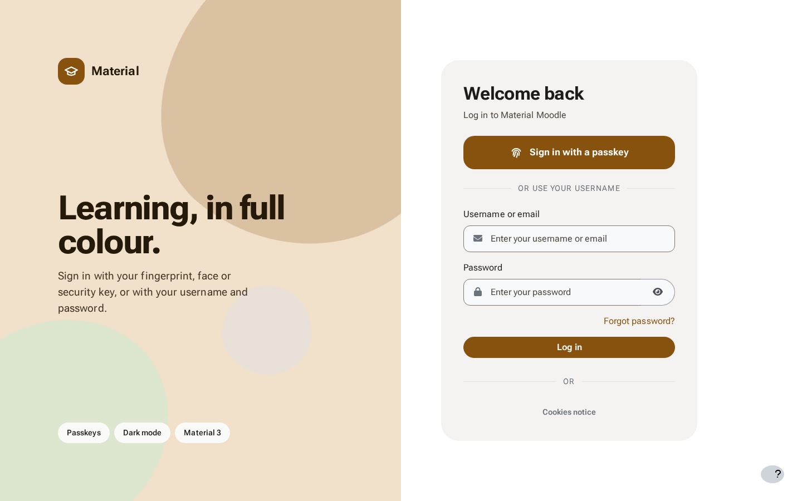
  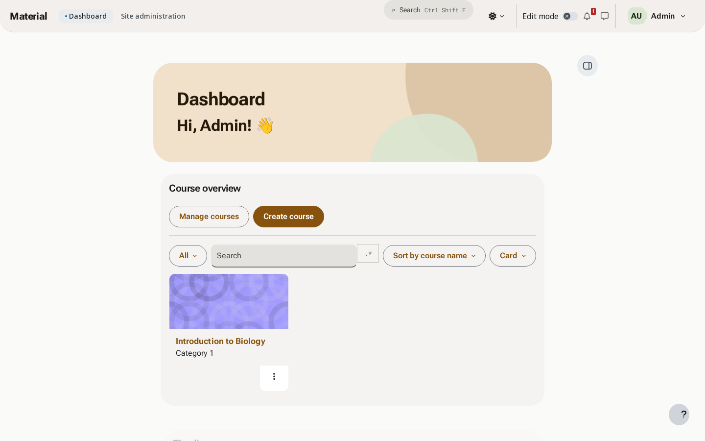
</p>

**Website:** <https://ding-ding-projects.github.io/material-moodle/> ·
**Download:** [latest release](https://github.com/Ding-Ding-Projects/material-moodle/releases/latest) ·
**Docs:** [material/docs](material/docs/README.md)

Each section below is folded so you can open just the part you need.

<details open>
<summary><strong>What you get</strong></summary>

| | |
| --- | --- |
| **Material 3 theme** (`theme_material`) | Palette generated from one seed colour, checked for WCAG AA contrast in light and dark mode; page transitions, spring motion and calm or off modes; works on phones with bottom sheets and large touch targets. |
| **Search everywhere** | Ctrl+Shift+F command palette across courses, page links and site settings, with a visual regex builder. Every search box on every page gets the same regex builder and live filtering. |
| **Right-click menu** | Copy, search for the selection, open links, back, reload, print, each with its shortcut. Shift + right-click opens the browser menu. |
| **Copy buttons and celebrations** | A copy button on every code block. Success messages burst with confetti; errors shake and flash. |
| **Passkey sign-in** (`auth_passkey`) | "Sign in with a passkey" on the sign-in page, a passkey manager in preferences, and an optional passkey step after a new account's first sign-in. Passwords keep working. |
| **Add a student** (`local_materialtools`) | Creates the account and gives you a message ready to paste into Discord, with the username and the password each in their own code block. The student must choose a new password at first sign-in. |
| **Custom vocabulary pack** | Upload a JSON file of replacement words and choose who sees it: nobody, everyone signed in, or selected students and cohorts. Signed-out pages always keep the original wording. |
| **Names that fit your school** | Rename Teacher, Student and Assignment site-wide; give one assignment its own type name such as "Dropbox" with a "Post a new Dropbox" button; give one person their own title while their role stays the same. |
| **First-run setup** | A wizard for the first administrator: colour, sign-in page, passkeys, vocabulary and wording. |
| **Docker stack** | PostgreSQL, Moodle and cron, installed automatically on first start, with an optional Cloudflare quick tunnel or named tunnel. |
| **Desktop deployer** | Deploys the stack to any Linux server over SSH and sets up a Cloudflare tunnel with a guided sign-in. |

</details>

<details>
<summary><strong>Screenshots</strong></summary>

| | |
| --- | --- |
| 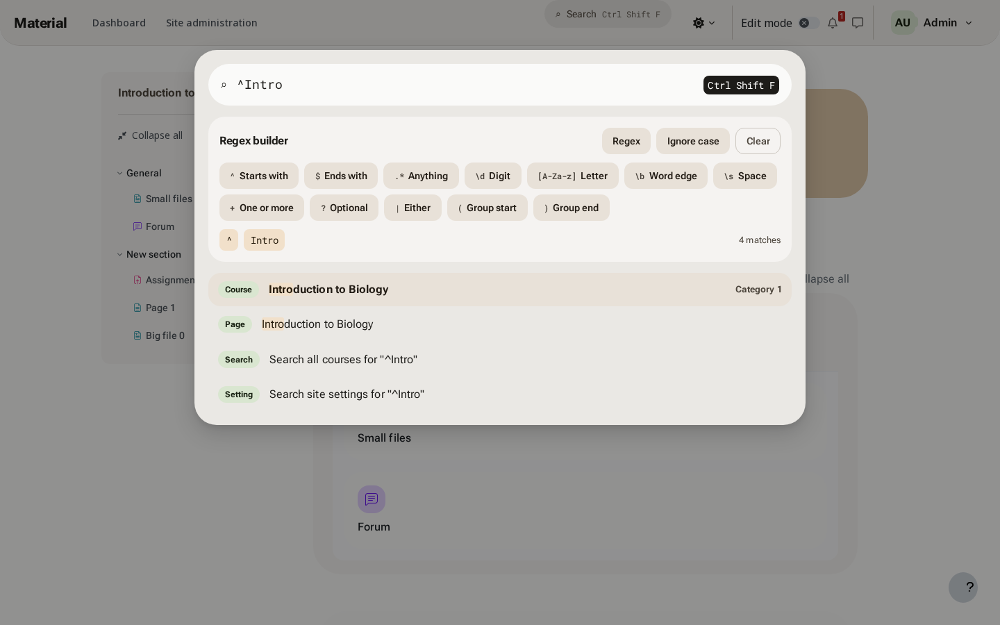 | 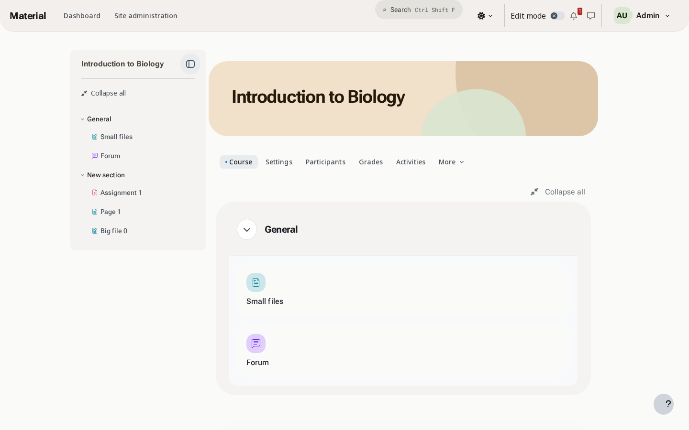 |
| 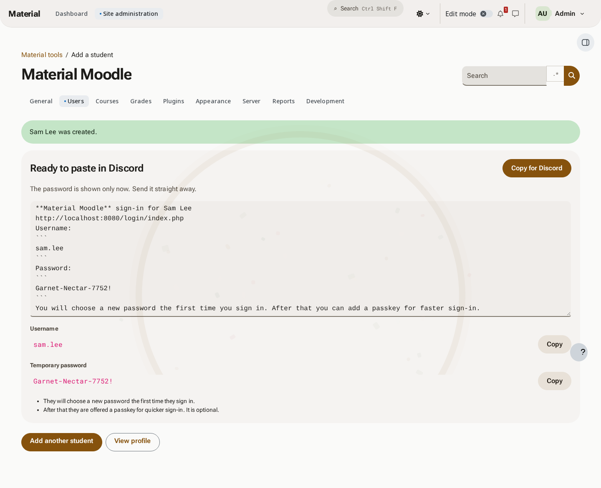 | 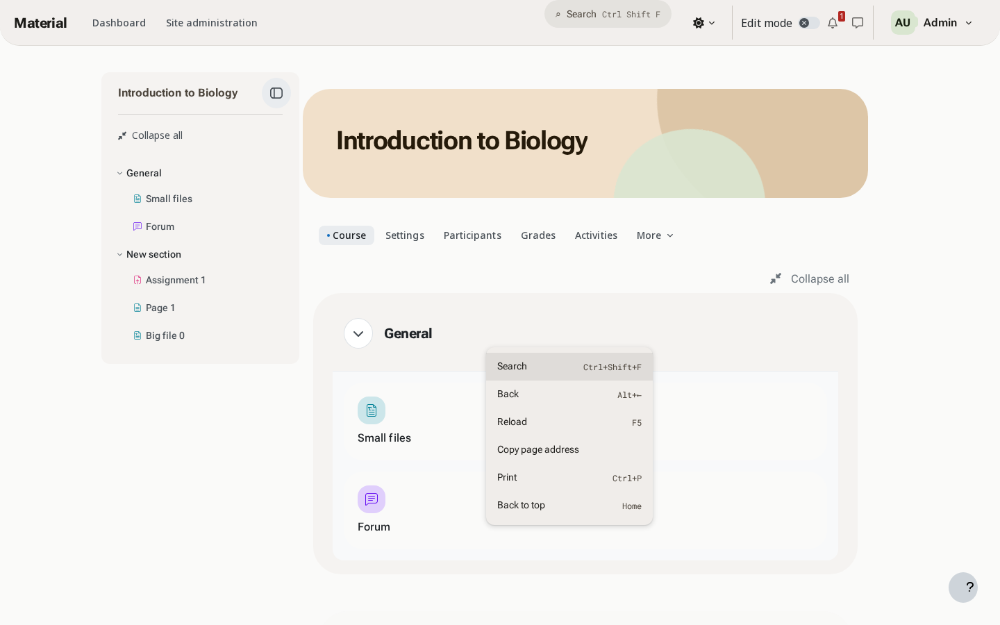 |
| 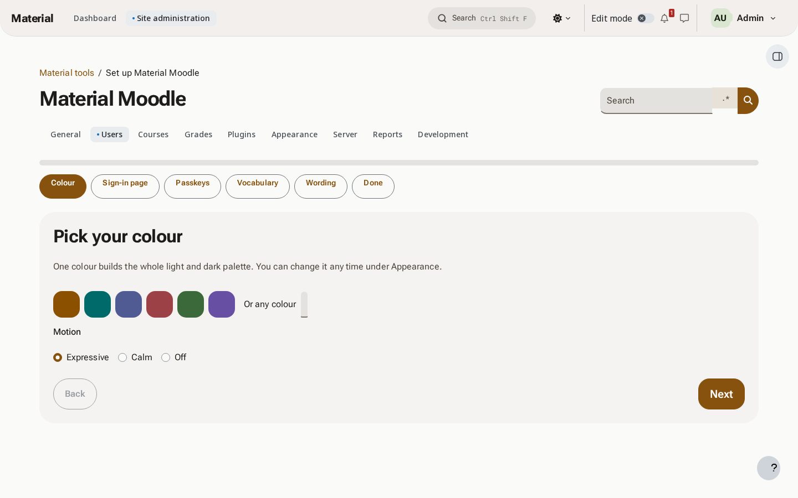 | 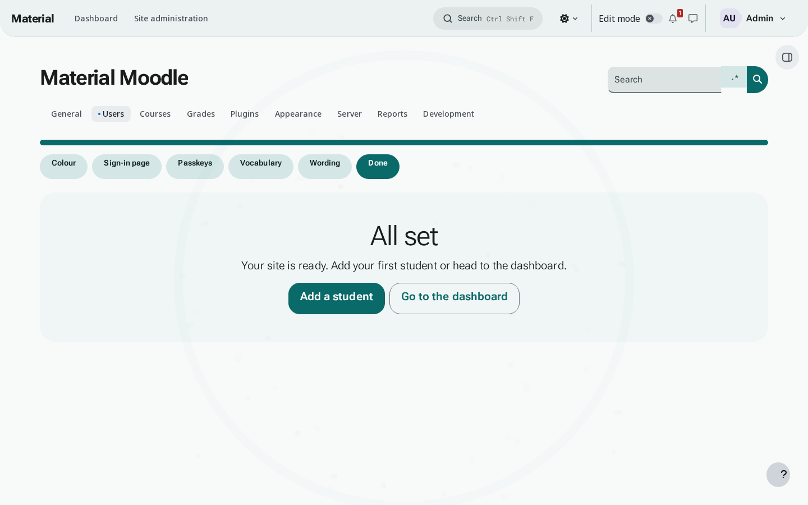 |
| 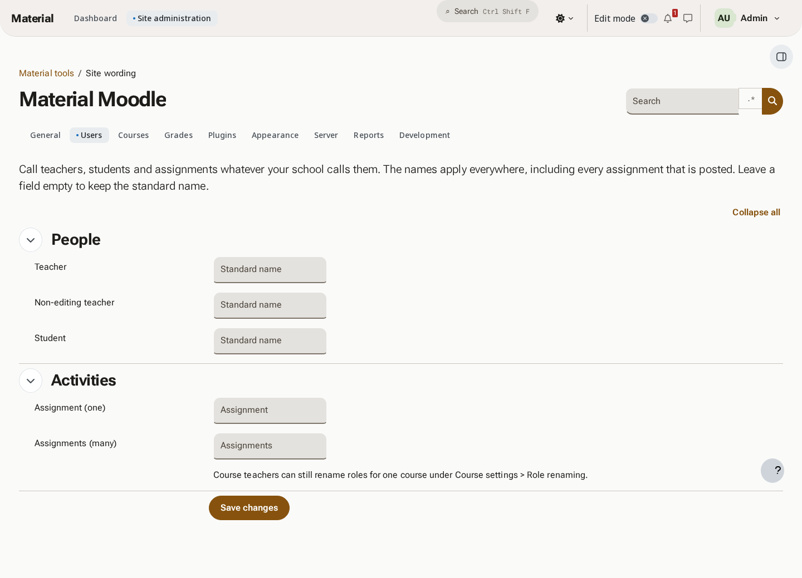 | 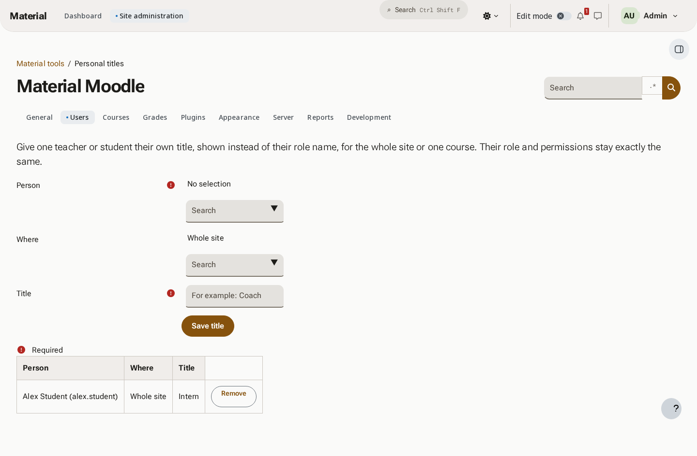 |
| 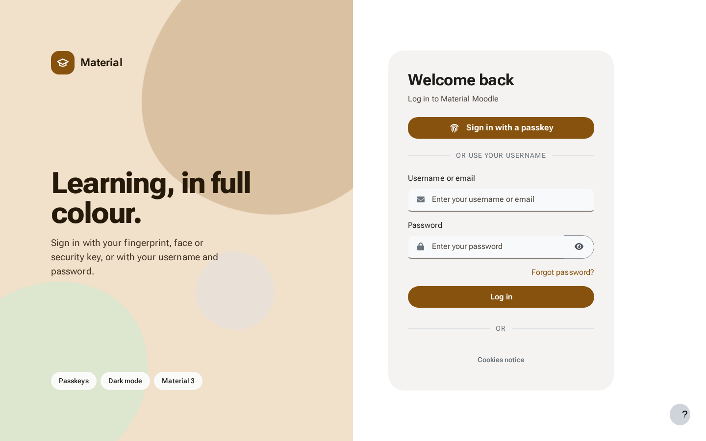 | 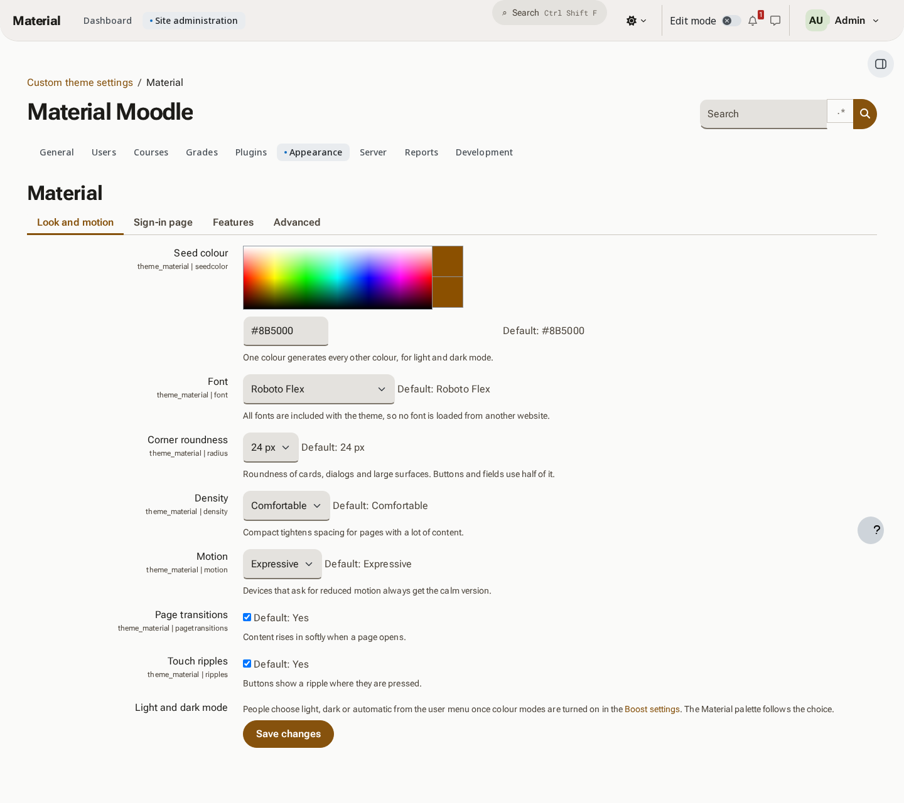 |

On a phone:

<p>
  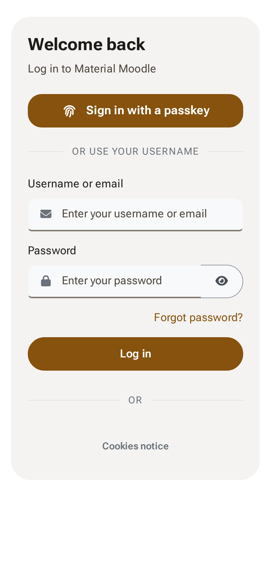
  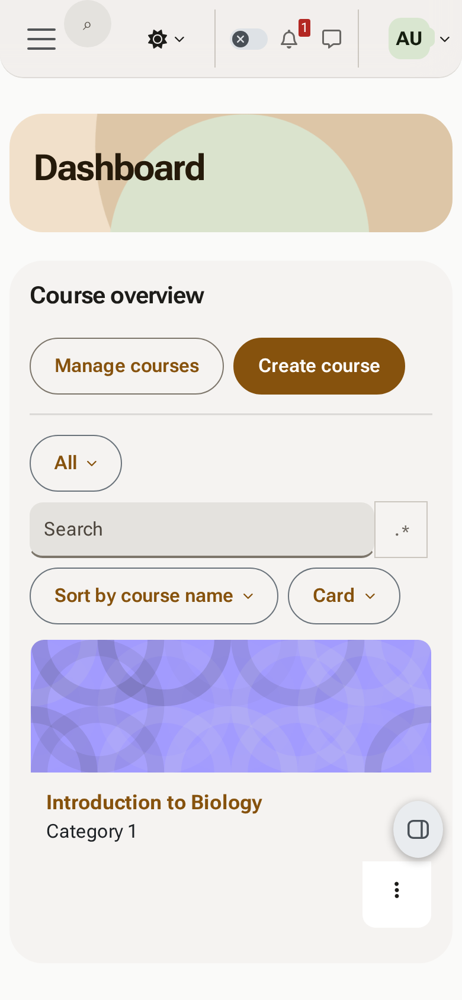
  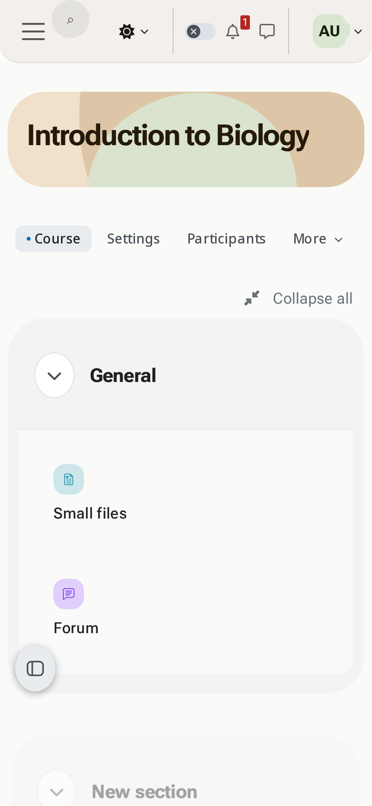
</p>

</details>

<details>
<summary><strong>Install with the desktop deployer</strong></summary>

1. Download the deployer for Windows, macOS or Linux from the
   [latest release](https://github.com/Ding-Ding-Projects/material-moodle/releases/latest). The installers are not
   code-signed, so your system may ask you to confirm the first start.
2. Enter your server's address and SSH sign-in, then choose **Deploy with one click**. Docker is installed if it is
   missing.
3. On the **Tunnel** page pick a quick link (no account needed) or your own domain, where the app walks you through
   the Cloudflare sign-in.

</details>

<details>
<summary><strong>Install with Docker</strong></summary>

One command on any Linux machine or Mac with Docker (it installs Docker on Linux if it is missing):

```sh
bash <(curl -fsSL https://raw.githubusercontent.com/Ding-Ding-Projects/material-moodle/main/material/install.sh)
```

It asks a few questions in a terminal menu (site name, administrator, how people reach the site: your network, a
free public https link from Cloudflare, or your own domain), generates the passwords and the `.env` file for you,
starts the stack, waits until Moodle is ready and prints the link. Run it again to see the link, or with
`--reconfigure` to change your answers. For automation, pass `--yes` with `MM_*` variables (see the top of
[material/install.sh](material/install.sh)). Details: [Docker stack](material/docs/docker-stack.md) and
[Cloudflare tunnels](material/docs/cloudflare-tunnels.md).

</details>

<details>
<summary><strong>Use the ready-made server image</strong></summary>

Each release has a server image: an `.ova` for VirtualBox and VMware, a `.qcow2` disk, a PC image for a USB
stick, and a Raspberry Pi 4/5 image. Start it and answer the menu on its screen; it shows the link and the
administrator password when it is done. Details: [Server image](material/docs/appliance.md).

</details>

<details>
<summary><strong>Install into an existing Moodle 6 site</strong></summary>

Copy `public/theme/material`, `public/auth/passkey` and `public/local/materialtools` into the same places in your
Moodle, visit Site administration to finish the upgrade, choose the Material theme under Appearance, and enable
Passkeys under Plugins › Authentication. Each plugin is also attached to every release as an installable zip.

</details>

<details>
<summary><strong>Settings</strong></summary>

Everything is configurable in Site administration:

- **Appearance › Themes › Material**: seed colour, font, corner roundness, density, motion, page transitions,
  ripples, sign-in heading, text, labels and image, command palette, regex builder, right-click menu, copy buttons,
  celebrations and their level, raw SCSS.
- **Plugins › Authentication › Passkeys**: device prompt name, user verification, timeout, offer to new accounts.
- **Users › Material tools**: setup wizard, add a student, custom vocabulary, personal titles, site wording, and the
  student account settings (credentials message template, password style, quick post buttons, enrolment role).

See the [administration settings reference](material/docs/administration-settings.md).

</details>

<details>
<summary><strong>For developers</strong></summary>

- The Material additions are a separate overlay on top of upstream Moodle; see [AGENTS.md](AGENTS.md) for the map.
- Browser modules are hand-written AMD in `amd/src`; run `material/scripts/build-amd.sh` after changes.
- The palette has unit tests in `public/theme/material/tests`.
- Roadmap: [material/ROADMAP.md](material/ROADMAP.md). Feature inventory: [material/COMPLETENESS.md](material/COMPLETENESS.md).

</details>

<details>
<summary><strong>About Moodle and licence</strong></summary>

This project is built on [Moodle](https://moodle.org), the open source learning platform, and keeps all of
Moodle's own code and history. Moodle is provided under version 3 of the GNU General Public License, and so is
everything in this repository. See [COPYING.txt](COPYING.txt). "Moodle" is a trademark of Moodle Pty Ltd; this
project is not affiliated with or endorsed by Moodle Pty Ltd.

Fonts: Roboto Flex, Roboto Mono, Inter and Atkinson Hyperlegible Next, each under the SIL Open Font License.

</details>
