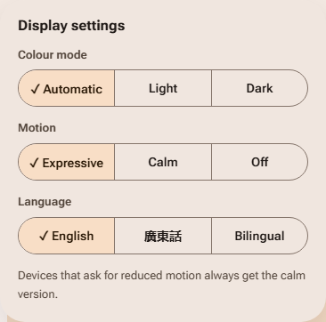
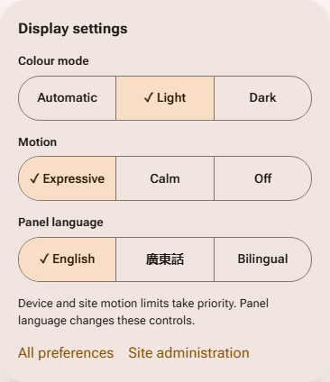

# Material Moodle design references

The selected visual reference is the [interactive demo](../site/demo.html). Its
[stylesheet](../site/assets/css/site.css) defines the default palette, typography,
spacing, shapes and panel treatments. Its [script](../site/assets/js/demo.js)
uses sample data for the illustrated workflows. The demo is maintained in its
original location; this folder records comparisons with the running Moodle theme.

## Display settings

| Demo | Moodle course editor |
| --- | --- |
|  |  |

The two panel crops were captured at a 390 × 720 CSS-pixel viewport, light theme
and default text size. The reference is the demo at revision
`d5ccd452b445b775a4e1550736496f1668bbeaa6`. The Moodle crop is from an
isolated installation with the theme and local tools at version `2026112201`.

Both panels are 366 CSS pixels wide and use the default high surface colour
`#F0E6DF`. The Moodle version has 48-pixel touch targets and links to actual
preferences and permitted administration pages. Those additions make it taller.
Panel wording can switch between English, Cantonese and both. Course content and
the installed Moodle language use their usual settings.

The previous phone menu started at y = −103 px, above its 65-pixel toolbar.
Its first two choices could not receive a tap. The current panel was checked at
320 × 568, 390 × 720, 740 × 320 and 1280 × 800. All nine choices could be
reached, including by scrolling the panel in landscape. Escape dismissed it
in Chromium and WebKit. The site and device motion limits take precedence.

## Other demo surfaces

The theme uses the demo's light and dark colour roles for its default seed.
The sign-in card follows the 440-pixel maximum width, with 32-pixel desktop
padding and 22-pixel phone padding. The command palette uses an inset rounded
panel on phones. Whole-screen parity across every Moodle page remains open.
The demo's simulated device prompt and sample deployment outcomes are examples.
Authentication and deployment results in the product come from their actual services.
